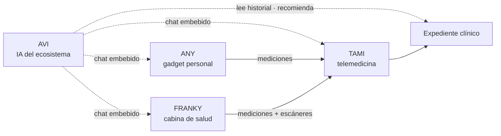

# Branding — Productos del ecosistema

Catálogo de los **productos** de LiberSalus: qué es cada uno y cómo se conectan
entre sí. Es un documento de **marca y ecosistema**, no de implementación.

## Productos

| Producto | Nombre | Tipo | Rol | Host |
|---|---|---|---|---|
| [`avi.md`](avi.md) | Asistente Virtual Inteligente | Software (S.O. + chat) | **Cerebro** del ecosistema: entiende el historial y recomienda | — |
| [`any.md`](any.md) | ANY | Hardware | Gadget personal: mediciones y seguimiento | — |
| [`franky.md`](franky.md) | FRANKY | Hardware | Cabina de salud: mediciones y escáneres | — |
| [`tami.md`](tami.md) | TAMI | Software (web) | Plataforma de **telemedicina** | `tami.libersalus.dev` |

> **Único con host web**: TAMI. AVI (software de sistema operativo), ANY y FRANKY
> (hardware) no se sirven como sitio.

## Cómo se conectan

- **AVI** es transversal: presencia en el sistema operativo (voz) y **chat en
  todas las plataformas**.
- **ANY** y **FRANKY** son **hardware** que alimenta la teleconsulta de TAMI.
- **TAMI** es la plataforma de telemedicina donde ocurre la consulta.
