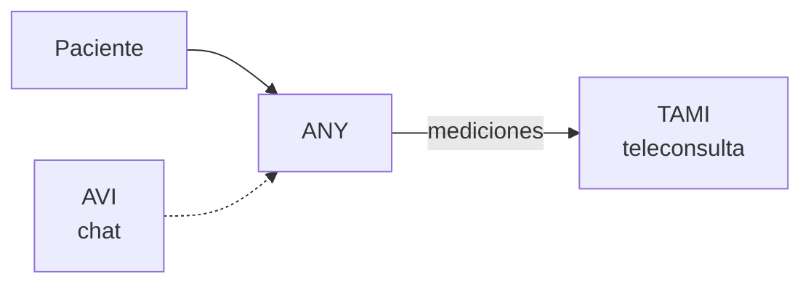

# ANY — gadget personal

**Tipo:** hardware.
**Rol:** auxiliar personal de **tratamientos, seguimiento y mediciones**.

## Qué es

Dispositivo personal que acompaña al paciente en su tratamiento y seguimiento.
Toma **mediciones** y las integra al ecosistema digital.

## Cómo se conecta

- Se enlaza con **TAMI** durante una **teleconsulta**: las mediciones alimentan
  la consulta.
- El profesional ve las mediciones en el contexto de la teleconsulta.
- **AVI** está presente como **chat** dentro del producto.

## Host

**No tiene host propio** (es hardware).
