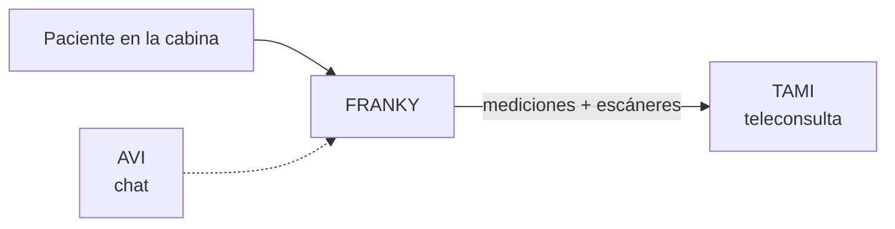

# FRANKY — cabina de salud

**Tipo:** hardware.
**Rol:** punto de **seguimiento y mediciones** distribuido en la ciudad.

## Qué es

La **cabina de salud más grande** del ecosistema. Se despliega en **distintos
puntos de una ciudad**, para que el paciente se mida sin depender de un gadget
personal.

## Qué la distingue de ANY

Comparte el propósito (seguimiento con **teleconsulta**), pero dentro de la
cabina hay **más capacidad**:

- **Más escáneres.**
- **Más aparatos de medición.**

## Cómo se conecta

- Igual que ANY, sus mediciones alimentan una **teleconsulta** de **TAMI**.
- **AVI** está presente como **chat** dentro del producto.

## Host

**No tiene host propio** (es hardware).
