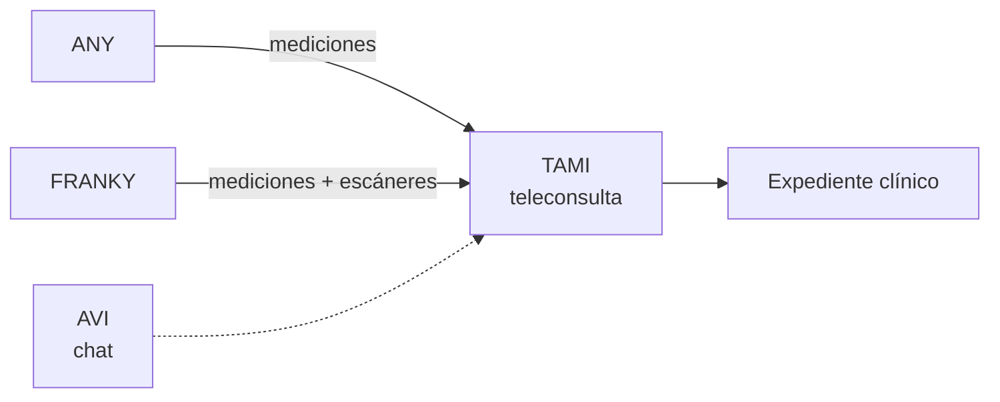

# TAMI — telemedicina

**Tipo:** software, **con versión web**.
**Rol:** la plataforma de **teleconsulta** del ecosistema.

## Qué es

La herramienta de **telemedicina** de LiberSalus: la consulta a distancia entre
paciente y profesional de salud. Funciona como un *meet / zoom* orientado a la
salud.

## Rol en el ecosistema

- Es el **destino** de las mediciones de **ANY** (gadget personal) y de
  **FRANKY** (cabina): durante la teleconsulta, el profesional ve las mediciones
  en contexto.
- **AVI** está presente como **chat** dentro de la plataforma.
- La consulta alimenta el **expediente clínico**.

## Host

Es el **único producto con host web**:

| Ambiente | URL |
|---|---|
| `DEV` | `tami.libersalus.dev` |
| `QA` | `tami.libersalus.qa` |
| `PROD` | `tami.libersalus.com` |

> El mapa de dominios del entorno está en `docs_devops/guides/domains.md`.
